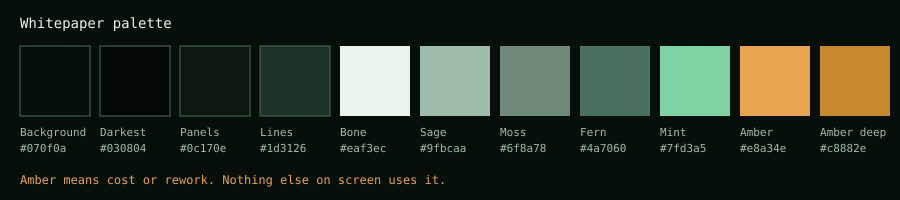

# Remotion Video Playbook: prompts and context that worked for me

These are the prompts, style rules and render notes behind the Remotion videos I have built with Claude, collected from my chat history. Prompts are quoted from my own messages, with repo links replaced by placeholders. Everything else is summarized.

## How the LEGO video got made

I saw a video online where someone built something out of LEGO pieces and everything clicked into place. I wanted to explain my Chromatic Architecture framework that way, so I gave Claude the repo and asked it to review the material before proposing anything. The first cut showed the pieces coming together.

A friend watched it and said to start from the end goal. I took that back to Claude and asked it to evaluate the idea. The second cut opens on the job to be done and then shows which pieces fit. It also shows that real systems are made of smaller systems, like a LEGO set where one piece is a ship and another is a plane.

The prompts below are the ones that got me there.

**The takeaway:** give Claude the source, the audience, and a reference for the feel. Ask for a proposal before a build. Then react to something you can watch, such as a mock or a still.

## Start here: a prompt template

Copy this, fill in the blanks, and send it as your first message.

> I want to create a Remotion video about [topic]. The source material is [repo link, attached files, or page]. Read [specific files] first, then propose a video before building anything.
>
> Audience: [who will watch and what they should walk away with]. It will live on [site, talk, social, or a private share].
>
> Feel: [a reference you have seen, such as pieces snapping together, falling text, a museum walk].
>
> Format: [length range, 16:9 or vertical, silent or with voiceover].
>
> Style: [palette hex codes and fonts, or "match the site"].

After the proposal, ask for a mock or a few stills. Reply with one specific change at a time.

## Two things to do before you share a video

1. **Label what is real and what is illustrative.** If the video uses real data, every figure needs a source. If it uses placeholders, tag them (my Observatory mock carried a "MOCK · SAMPLE DATA" label). A correction after friends have watched costs more than a label up front.
2. **Judge quality from full-size stills.** Half-scale previews look soft, and my first BTA renders looked out of focus for that reason. Render a still at full resolution before deciding a scene needs rework.

## The videos, at a glance

| Video | What made it work |
|---|---|
| Chromatic Architecture (LEGO bricks), 2:16 to 2:31 | Imports the site's real brick renderer and data, so verdicts are computed and not typed in |
| BTA brick, seismograph and tree-ring explainers | One metaphor per video, figures taken only from published analyses |
| Data: Pace Layers (80s), water cut (64s), From Reporting to Self-Service (110s) | A written palette and type spec given up front |
| Linguistic Debt prism and five spin-offs | Metaphor swapped when I asked for alternatives; one reusable scene run twice |
| Observatory context video (Matrix rain, 96s, vertical and wide) | Mock first, then iterate on my reaction |
| DevSecOps consultant briefing, 75 to 90s | Project rules and one config file for copy, colors and timings |
| Museum walkthrough, about 3 min | I set the format (linear, ten exhibits, silent) and invited creative additions |

## The best prompts, verbatim

### 1. Chromatic Architecture: the original ask

> I want to create an animated overview of this idea of this project `<repo link>` review the materials, framework and concepts and then lets figure figure how to make a compelling and clean animated overview (maybe even using something like a remotion style picture -> words -> etc to show the concepts and ideas. I saw a really slick video online of you taking a bunch of lego pieces and building something and all the pieces came together. I was curious if we could do the same thing as a way of explaining the concepts to the audience for this concept.

Why it worked: it gave the repo, asked for a review before a concept, named the reference style (pieces coming together), and named the teaching structure (picture, then word).

My follow-up that set the format:

> i think its a talk version for thejambot.com and i can record a gif of it but i do not want to show cut it apart for linkedin if i don't have to.

### 2. Chromatic Architecture: the goal-first rework

> Work in `<your repo>` on branch `video/animated-overview`. Read `video/HANDOFF.md` first, then `BRICKS.md` and `PRODUCT.md`. The video is a Remotion project in `video/` that imports the site's brick renderer and data from `preview/src`. I want to explore: a conversation with my friend that liked the idea but thought we should anchor it with the end in mind vs just showing the pieces together. for example, saying if you want to build a tool that allowed you to explore the data of a project team, you would want to evaluate these criteria and built it with that in mind and here are the different lego pieces that fit together. My friend also suggested evaluating if it was worth showing that these systems are frequently systems of systems similar to how when you build a lego set one large complicated piece might be a ship, the other one might be a plane and they each have their own ecosystem to consider.

Why it worked: it names the branch and the files to read first, so a fresh session has the context. It brings in outside feedback as a question to evaluate, not an instruction. The result was a four-act cut (the job, the questions, the data system up close, the whole set with open seams).

The opening slide I asked for, close to my own words:

> most projects kick off with people either describing the problem statement or listing the tools... no one really has a good way to figure out how the two fit together... this is why we want to build something like this to help bridge that gap

### 3. BTA explainers with metaphors

> i had good success using Remotion to create some video overviews for a concept i did and I wanted to do the same for these two repositories `<repo 1>` and `<repo 2>` and specifically the using concepts like legos or other metaphors to explain the ideas. Evaluate both the content from the website and the actual application's capabilities and propose a video overview using Remotion that would quickly explain the concept and be engaging.

Why it worked: it asks for an evaluation of both the marketing copy and the real application, then a proposal. That is why the storyboard separated what the app does from what the site says. Result: the sorting-bricks overview, seismograph loop, tree rings, and the Next.js and Kubernetes explainers.

Corrections I gave that shaped the later cuts:
- The explainers should speak to the person responsible for the upgrade or platform decision, not demo the product.
- I declined the Kubernetes median-close-time figures because content should not be produced solely for the sake of filling space if it risks misinterpretation.
- I flagged that previews looked out of focus. The cause was half-scale JPEG preview rendering. Final renders use full resolution.
- I picked tree rings as the strongest metaphor and asked to open on the whole tree (canopy for fast-moving work, roots for long-running structural ideas) before cutting to the cross-section.

### 4. A palette and type spec up front

> I have three videos I want to create for thejambot.com and I want to share the colors and styles as well as the prompts for each videos. I want them to be done using Remotion

Followed by the spec (see "Reusable style blocks" below). Giving the spec before the scenes is what kept the three films consistent.

### 5. Linguistic Debt: scene direction

> i think the beginning scene should say "done" and what it means when there are multiple people with different perspectives in the room (CTO, Product Leader, Head of Customer Experience, Head of QA, Lead Engineering) and we can do a scene for "done" with the prism and then do another one for "deployment" and have another prism.

Pacing request:

> can we extend this to 60-75 seconds so the concepts have more time to breath.

This turned one scene into a reusable component run twice, which is a good pattern for any repeated beat.

### 6. Observatory context video

The idea that changed the video:

> I can and what if we extend it to be like a part of the matrix where the green screen is showing the text but then it evolves to show patterns and the context we are talking about

The workflow that followed:

> Can you do a mock video so I can see it while I get the data for you?

> Can you create an even more sophisticated version of this with more animations and let me know if I should shift to a higher model like a fable to see what you come up with

> yes, please do that - i want to see it fill the screen when i open the video

Why it worked: a labeled mock on synthetic data let me react to look and pacing before the real data arrived. The vertical build was then rebuilt as one layout that adapts to 16:9, 1:1 and 4:5.

### 7. DevSecOps briefing

> i'd like you to expand everything to capture the entire thing as a 75-90 second video with animations, metaphors and other insights.

Project rules I set:
- All video built as Remotion compositions in `src/`.
- Animate only with `useCurrentFrame`, `interpolate` and `spring`. Never CSS transitions or animations.
- Default 1920x1080 at 30fps.
- Keep copy, colors and timings in one data/config file.
- After each change, render a still with `npx remotion still` and inspect it before calling it done.

### 8. Museum walkthrough

My direction after the proposal: build it as an interactive player, keep it a linear museum walk, retain all ten lens exhibits, standalone with no music or narration yet, and build on the visuals and concepts creatively. When scene colors did not change and the motion missed my vision, the rebuild gave each Act its own color world and added cross-dissolves.

## The pattern behind the best prompts

1. Point at the source: a repo link, a branch, or attached files, plus the files to read first.
2. Ask for an evaluation or a proposal before a build.
3. Name a reference for the feel (pieces coming together, the Matrix rain, a museum walk).
4. State the audience and where it lives (talk version for a site, a buyer, a partner).
5. State format limits (silent, no LinkedIn cut, length range).
6. Look at a mock or stills, then redirect with one specific change.

## Copy-paste recipes

General prompts for making videos with [Remotion](https://www.remotion.dev/), the React-based video framework, using Claude Code or any coding agent. A video is just code, so the agent can write it, preview it, and re-render it.

### How to use these

1. Create an empty folder and open your coding agent in it.
2. Paste the setup prompt first.
3. Paste one of the recipes below, replacing anything in [brackets].
4. Iterate one scene at a time in the Studio, then export.

### Setup prompt (always send first)

```
Scaffold a Remotion project with `npx create-video@latest` (TypeScript, blank template).
Start the Studio with `npx remotion studio`. Build everything I ask for as Remotion
compositions in src/. Use useCurrentFrame, interpolate and spring for all animation,
never CSS transitions or CSS animations. Default to 1920x1080 at 30fps unless I say
otherwise. Keep copy, colors and timings in one data/config file so I can edit them
without touching components. After each change, render a still with
`npx remotion still` and inspect it before telling me it's done.
```

### Recipes

**1. Explainer from a script**

```
Build a 45-second explainer video in Remotion from this script: [paste script].
One <Sequence> per sentence, with duration derived from word count. Use large kinetic
typography on a dark background, a different accent color per scene, and a
spring-based entrance for each line. Put all copy and timings in a single data file.
```

**2. Data-driven animated chart**

```
Read data.csv and make a 20-second Remotion video that animates it as a bar chart
race. Bars spring into place, labels count up, and the title fades in. Make the
composition accept props via a zod schema so I can swap the dataset from the Studio
sidebar.
```

**3. Product or feature demo**

```
Make a 30-second Remotion launch video for [product]. Scenes: problem, solution,
three feature callouts, call to action. Use a faux browser window component with an
animated cursor and click ripples. Add a vertical 1080x1920 composition that reuses
the same scenes.
```

**4. Diagram or architecture walkthrough**

```
Turn this SVG diagram into a Remotion video: [paste or point to file]. Draw each node
and arrow in sequence with stroke-dashoffset animation, and highlight one component
at a time while a caption explains it. Total length 40 seconds. Captions come from an
editable array.
```

**5. Batch personalized videos**

```
Create one Remotion composition with props {name, company, metric}. Then write a
script using @remotion/renderer that reads people.json and renders one MP4 per row
into out/. Show the name and metric on an animated title card.
```

**6. Voiceover and captions**

```
Add public/voiceover.mp3 to my composition. Generate word-level captions with
@remotion/captions (or Whisper) and render them as TikTok-style highlighted
subtitles. Sync scene changes to caption timestamps.
```

**7. Social cutdowns**

```
Take my existing 16:9 composition and add 1:1 and 9:16 variants as separate
compositions that share the same scene components. Reflow layout per aspect ratio
instead of just scaling. Keep text inside safe margins.
```

**8. Motion graphics intro/outro**

```
Make a reusable 4-second logo sting as a Remotion composition: logo mask-reveals,
a color wipe, then a tagline. Expose duration, colors and tagline as props. Export it
as a standalone composition I can <Sequence> into other videos.
```

### Tips

- **One scene at a time.** Asking for the whole video at once tends to produce generic output.
- **State constraints.** Duration, fps, aspect ratio, palette, fonts (load with `@remotion/google-fonts`).
- **Make the agent look.** Tell it to render stills and check them. Without that, it can't see what it made.
- **Prefer props over hardcoding.** A zod schema gives you editable controls in the Studio.
- **Reuse scenes.** Build scene components once, then compose them into multiple formats.

### Handy commands

| Task | Command |
|---|---|
| Create project | `npx create-video@latest` |
| Open Studio | `npx remotion studio` |
| Render a still | `npx remotion still <CompositionId> out/frame.png --frame=30` |
| Render video | `npx remotion render <CompositionId> out/video.mp4` |

### Troubleshooting prompts

- **Animation looks jumpy:** "Replace any CSS transitions with interpolate/spring driven by useCurrentFrame."
- **Timing is off:** "Show me the frame ranges for each <Sequence> and fix any overlaps or gaps."
- **Text overflows:** "Render stills at the first, middle and last frame of every scene and fix any clipping."
- **Render is slow:** "Find the heaviest components per frame and memoize or simplify them."

### Notes

- Remotion has its own licence terms for commercial use. Check [remotion.dev/license](https://www.remotion.dev/license) before shipping paid work.
- Commands and package names change over time. If something fails, check the current docs at [remotion.dev/docs](https://www.remotion.dev/docs).

## Reusable style blocks

### Whitepaper palette (thejambot.com films)



| Role | Hex |
|---|---|
| Background | `#070f0a` |
| Darkest ground | `#030804` |
| Panels | `#0c170e` |
| Lines | `#1d3126` |
| Bone (primary text) | `#eaf3ec` |
| Sage | `#9fbcaa` |
| Moss | `#6f8a78` |
| Fern | `#4a7060` |
| Mint (highlight) | `#7fd3a5` |
| Amber | `#e8a34e` |
| Amber deep | `#c8882e` |

Rules: light bands in the prisms use greens and bone, not a rainbow. Amber is reserved for cost, such as a band landing on a receiver that reads it wrong. Departure Mono for labels and big words, Manrope for body text.

### BTA "Clean Technical Dossier" palette

Paper `#f7faf7`, forest `#173f35`, cobalt for sources, signal yellow for attention. Comes from the BTA `DESIGN.md`.

### Chromatic Architecture grammar

Brick = capability, colour = role, label = product, height = tier. Verdicts such as snaps together, loose, forced fit and looks built, reads wrong come from `readBuild`. Keep the on-screen line that stacking shows relationships, not data flow.

## Visual cues and guidelines

### Color

- Pick one palette before the first scene and put the hex codes and fonts in the prompt.
- Give each color one job. In the Linguistic Debt films amber appears only where something costs time or rework. In Chromatic Architecture, color marks a role and nothing else.
- Keep the background and chrome neutral so color carries the meaning.
- When a video has distinct parts, give each part its own color world and cross-dissolve between them. The museum walkthrough uses indigo, teal and amber, green, gold, and violet for its five Acts.

### Motion

- One idea per beat. The visual change lands at the same moment as its word (picture, then word).
- Animate with `spring` and `interpolate`, and seed any randomness (rain, bricks) so every render is identical.
- Hold a finished scene for 2 to 5 seconds with its caption on screen. Let only small motion continue, such as pulses or drifting particles.
- Give a concept room. My prism act felt rushed at 36 seconds and worked at 66.
- For a cinematic feel, use a slow push-in, a dolly, then a settle. Limit motion blur to the camera transition. Finish with depth shading, film grain and a vignette. The tree-ring video got its look this way, and the gain came from scene construction and render settings.
- For data-as-texture scenes (the Observatory rain), use parallax layers, text that decodes into file names, light packets moving along graph edges, and a shockwave at the focal node.

### Framing and type

- Make captions carry the story so the video works muted. Voiceover can come later, and it usually needs re-timing.
- Keep type large enough to read at 1080p. Small UI type and a crowded final pull-back were the two legibility problems I had to fix.
- Build one layout that adapts to 16:9, 1:1 and vertical. Retrofitting later is about as much work as the first build.
- Show product names as sticker text, never vendor logos. Use generic building bricks with no LEGO name or logo.
- Tag mocks and illustrative parts on screen.

### Storyboard template

Ask for a table like this before any build, then change it scene by scene.

| Time | Scene | On-screen action | Caption |
|---|---|---|---|
| 0:00 to 0:08 | The pile | Mixed bricks fall in and a counter climbs | "A project can have thousands of tickets. Nobody remembers all of them." |
| 0:08 to 0:20 | Sorted by color | Bricks sort into label bins | "Labels sort by color. The same problem can wear three different colors." |
| ... | ... | ... | ... |

### Check the work

- Render a still at the peak-content frame of every scene before calling it done.
- Look at the stills at full size, then render the video.

## Accuracy rules I use

- No causal language. Use "reported" and "worth checking".
- Every dated figure comes from the published analyses, with a footnote that figures are dated and not live status.
- No contributor names or avatars.
- Label what is illustrative and what is real. Mocks carry a "MOCK · SAMPLE DATA" tag.
- No composite scores or verdicts in BTA videos.
- Use BTA's defined vocabulary precisely.
- Claims in the film must not exceed what the site's data proves.

## Render and environment notes

- The sandbox cannot download Remotion's own browser. Pass `--browser-executable=<path>` on every `remotion still` and `remotion render`. The working path differed between sessions (`/opt/google/chrome/chrome` with `--chrome-mode=chrome-for-testing`, a Playwright chromium, or `@sparticuz/chromium` from npm), so check which exists first. On a normal machine plain `npx remotion still` should work.
- Bundle once with `npx remotion bundle src/index.ts --out-dir build`, then render stills from `build`. This is much faster for iteration.
- Render stills at scattered frames with `--scale=0.4` to find a failing scene before a full render.
- Final renders: `--image-format=png --crf=16`. Do not judge quality from the half-scale JPEG preview.
- The sandbox had 2 CPU cores, so queue full renders.
- Zip source projects excluding `node_modules` and `out/`.
- Install the real font files (such as Departure Mono) so renders do not fall back to a substitute.

## Decisions I made that apply to future videos

- Plain video pages with chapter buttons and a short "The idea" explanation, not interactive scene-by-scene embeds.
- Remove music when it is not wanted. The silent cut comes from dropping the audio track, not re-rendering.
- Work on branches and review preview URLs before merging.

## Open follow-ups

- Sound design, a cinematic treatment for the Kubernetes video, a consultant day-one variant, and 9:16 cut-downs (BTA explainers).
- Chromatic Architecture: some platform pairings are missing from the Foundations data, so one verdict reads "Holds, with loose parts"; the three upper systems in the final pull-back are small at 1080p; voiceover would need re-timing.
- A prism version for Chromatic Architecture that shows composition, as the opposite of Linguistic Debt's dispersion.
- Observatory video: swap in one real BTA finding and real Observatory data in place of sample data.
